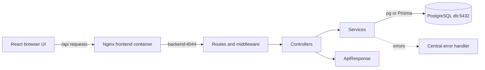

# LIS architecture and directory guide

The browser displays forms and reports. The Express backend validates requests, enforces permissions and runs laboratory workflows. PostgreSQL stores the saved catalogue, orders, results and audit history.



## What each directory contains

| Location | Responsibility |
| --- | --- |
| `frontend/src/components/` | Registration, catalogue, result entry, reports and reusable controls such as `CustomSelect` and `ClinicalNotesEditor`. |
| `frontend/src/hooks/useNavigation.ts` | URL parsing, navigation and browser Back/Forward handling. |
| `frontend/src/App.tsx` | Application shell, session state, current page and loading the order named in the URL. |
| `frontend/src/api.ts` | Authenticated API calls, response unwrapping, `ApiError` and downloads. |
| `frontend/src/types.ts` | Frontend data shapes. |
| `frontend/src/lib.ts` | Display formatting and immediate reference-range/flag previews. |
| `frontend/src/catalogueDraft.ts` | Converts saved catalogue data into editable form state. |
| `frontend/src/catalogueOptions.ts` | Dropdown suggestions and department defaults. |
| `frontend/src/catalogueTemplates.ts` | Optional templates that populate a draft for review before saving. |
| `frontend/src/styles.css` | Shared application styling and print rules. |
| `backend/src/routes/` | HTTP methods, paths and middleware/controller wiring. No SQL or workflow implementation. |
| `backend/src/controllers/` | Read validated inputs, call services and send responses. |
| `backend/src/services/` | Catalogue, account, sample, result, report and audit operations, including transaction boundaries. |
| `backend/src/schemas/` | Zod request, environment and library validation; inferred input types. |
| `backend/src/middleware/` | Authentication, role permissions, validation, security headers and centralized errors. |
| `backend/src/core/` | `AppError`, `ApiResponse` and `asyncHandler`. |
| `backend/src/database/` | Shared PostgreSQL pool, transaction helper and Prisma client. |
| `backend/src/config/` | Validated environment settings made available to the application. |
| `backend/src/types/` | Backend row types and Express type extensions. |
| `backend/src/utils/` | CSV utilities and locating SQL/JSON assets in source and compiled builds. |
| `backend/src/scripts/` | Schema initialization, seeding and Prisma connectivity checks. |
| `backend/src/app.ts` | Assemble Express middleware and routes; export the app for integration testing. |
| `backend/src/server.ts` | Listen on the configured port and close database connections on shutdown. |
| `backend/prisma/schema.prisma` | Database model used to generate the Prisma client. |
| `backend/generated/` | Generated Prisma code; regenerated during builds, not edited manually. |
| `backend/dist/`, `frontend/dist/` | Compiled build output. |
| `backend/test/` | API/database regression tests and browser checks with synthetic data. |
| `database/` | SQL schema, starter catalogue SQL and clinical-note suggestions. |
| `docker/nginx.conf` | Static frontend hosting, `/api` proxy and fallback for browser routes. |
| `docker-compose.yml` | Build and connect the database, API and frontend containers. |

## Follow one request

For **Submit & enter values**, `RegisterOrder.tsx` sends `POST /api/orders` with `entryMode: "RESULTS"`.

1. `orderRoutes.ts` checks the session and role, then validates the body using `createOrderSchema`.
2. `validate.ts` puts parsed data in `res.locals.input`; invalid requests go to the error handler.
3. `orderController.ts` calls `orderWorkflowService.createOrder` with the validated data and user.
4. The service opens a transaction, creates the patient/order snapshot and test snapshots, and calls `sampleService.prepareForEntry` to record acceptance and processing. Audit events are written in the same transaction. New measured results stay blank.
5. The controller returns `ApiResponse.created(order)`. `api.ts` unwraps `data`, and the frontend opens `/orders/<id>/results`.

Ordinary **Submit sample** uses `entryMode: "SAMPLE"` and leaves the sample registered for later acceptance.

## Shared responses and errors

Successful JSON responses have this shape:

```json
{ "success": true, "message": "Success", "data": {} }
```

Expected failures use `AppError` and return the appropriate HTTP status:

```json
{ "success": false, "message": "Investigation not found.", "code": "NOT_FOUND" }
```

Zod errors additionally contain field `details`. `asyncHandler` forwards rejected controller promises to `errorHandler`; unexpected failures return a generic 500 message without exposing exception text. CSV downloads return CSV, and 204 responses have no body. Services receive ordinary data and return data or throw errors; they do not send Express responses.

## Where seed and edited values are stored

| Source | Purpose and persistence |
| --- | --- |
| `database/002_seed_profiles.sql` | Inserts starter profiles and parameters into PostgreSQL when the catalogue is empty. Rerunning it does not overwrite the saved catalogue. |
| `database/report-descriptions.json` | Clinical-note suggestion library. The seed script fills only NULL descriptions; a deliberately saved empty string stays empty. |
| Frontend template/options arrays | Suggestions for an unsaved form. Choosing a template alone does not change PostgreSQL. |
| `test_profiles`, `profile_parameters` | Authoritative saved catalogue, including custom units, methods, codes and ranges. Saving the editor updates these records. |
| `lab_orders`, `order_tests`, `test_results` | Patient/order details, copied test metadata and measured results. |
| `audit_events`, `catalogue_audit_events`, `report_amendments` | Workflow changes, catalogue changes and preserved report revisions. |

An order copies the catalogue metadata when created. Editing the catalogue affects new orders. **Refresh reference ranges** deliberately updates an editable existing order with a recorded reason; it retains measured values and recalculates flags. Numeric results disable editing the interpretation-note field in the UI while preserving any existing note.

## How Docker fits together

`frontend/Dockerfile` has two stages. Node installs dependencies and builds React with Vite, including the catalogue guide. The second stage copies the static output into Nginx. `VITE_API_URL` is a build-time setting; Compose defaults it to `/api`, so the browser calls the same host that serves the frontend.

`backend/Dockerfile` also has two stages. The build stage installs dependencies, generates Prisma and compiles TypeScript. Its placeholder build database URL is used for generation; no live database is required to compile. The runtime stage installs production dependencies and copies compiled code and SQL/JSON assets. Its startup command runs schema initialization, seeding and then the API server.

`docker-compose.yml` provides the shared container network and environment settings:

- `db` runs PostgreSQL with the named `lis_postgres_data` volume. The SQL directory is mounted for first-time database initialization.
- `backend` waits for the database health check, connects to `db:5432`, and listens on port 4044.
- `frontend` waits for API health and exposes Nginx port 80 on the host's `FRONTEND_PORT` (default 8080).
- Nginx forwards `/api/` to `backend:4044`. Its `try_files` fallback serves React for URLs such as `/orders/<id>/report`, allowing reloads to restore that page.

For this local setup, the root `.env` selects `FRONTEND_PORT=8081`, so open **http://localhost:8081**. Compose uses the root `.env`; standalone Node/Vite development uses `backend/.env` and `frontend/.env`. Rebuild after changing frontend build-time settings. Recreating application containers retains the PostgreSQL volume.

## Type safety and remaining duplication

The backend uses strict TypeScript with JavaScript application sources disabled. Zod validates incoming data at runtime, and `z.infer` carries parsed shapes into services. Prisma generates types for its model queries. Prisma and raw `pg` queries share the PostgreSQL pool, but a `pg` transaction and a Prisma transaction are separate transaction contexts; operations within one transaction must use its provided client.

Raw SQL still needs runtime integration tests: declared row types do not verify SQL column names, placeholder counts or query results. Frontend `api<T>` types also do not validate response JSON at runtime. `database/001_schema.sql` is the schema initialization source used by this app; Prisma generation does not apply SQL changes. Keep it and `schema.prisma` aligned.

Repeated account creation, response construction, request validation, transaction handling, sample preparation and audit writes now have shared helpers. The frontend still duplicates backend reference matching/flag logic for immediate feedback; the backend remains authoritative when saving. Their regression checks must stay aligned when those rules change. Frontend/backend data contracts and SQL/Prisma definitions also require coordinated changes.

## Report editing and navigation

- An editable report has **Edit values**, which opens that order's results.
- An authorized report has **Amend & edit values** for administrators/authorizers. A reason is required, the prior version is preserved, and corrected results need authorization again. Measured-value entry remains restricted to administrators/technicians.
- Browser Back/Forward follows page navigation. Saved orders reopen from `/orders/<id>/results` and `/orders/<id>/report` after reload. Other pages use `/register`, `/samples`, `/tests`, `/team` and `/records`.
- Reload restores the page and saved order. Unsaved form edits and temporary worklist filters are not persisted.

## Verification commands

Run builds from their package directories:

```powershell
cd D:\lis\backend
npm.cmd run build
cd D:\lis\frontend
npm.cmd run build
```

From `D:\lis`, with Docker running and the backend image available:

```powershell
docker compose up -d db
docker compose run --rm --no-deps -v D:/lis/backend/dist:/app/dist:ro -v D:/lis/backend/test:/app/test:ro -v D:/lis/database:/database:ro -e LIS_CONTAINER_TEST=1 backend node test/run-disposable.mjs test/architecture.integration.test.js test/catalogue.integration.test.js test/reference-ranges.test.js
```

The runner creates a uniquely named local `_test` database and removes it afterwards. It tests request validation, authentication, response/error handling, direct entry, amendments, catalogue persistence and reference workflows. Its optional embedded catalogue browser case requires Playwright and a reachable frontend build. `backend/test/revision-browser.mjs` separately checks the built UI with synthetic API responses; set `PLAYWRIGHT_MODULE_PATH` to a local `playwright-core/index.mjs` and ensure its Chromium browser is installed.

Start/rebuild the local application with `docker compose up -d --build`. Check `docker compose ps`, **http://localhost:8081/health** and **http://localhost:8081/api/health**. The API health response wraps `database: "connected"` inside `data`.
